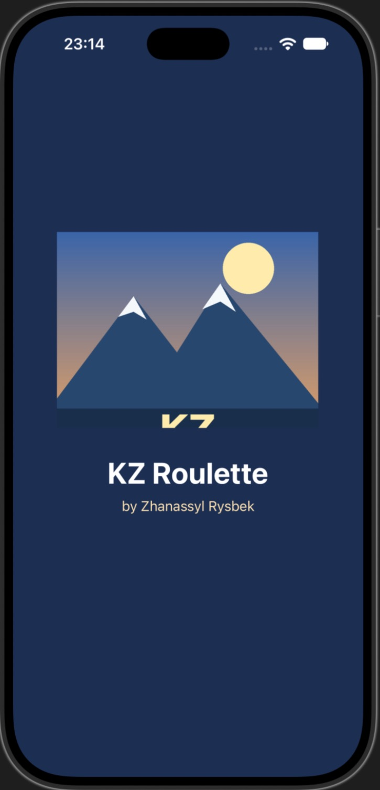
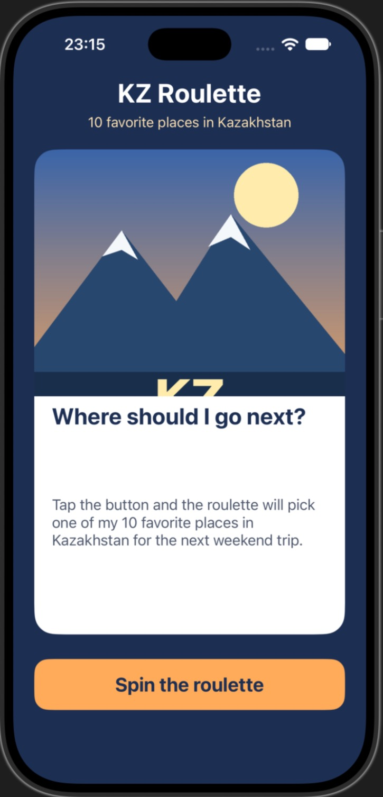

# Lab 6 · Favorites Roulette — KZ Roulette

Single-screen UIKit app (Storyboard, Swift). Category: **10 favorite places in Kazakhstan**.
Each tap on **Spin the roulette** shows a random place (image + title + description); the same place never appears twice in a row.

- Data: `struct Favorite` + array of 10 items in `ViewController.swift`
- Layout: `Main.storyboard`, no constraints (autoresizing masks only)
- Custom `LaunchScreen.storyboard` and custom 1024×1024 `AppIcon`
- No force unwraps except `@IBOutlet`s

## Screenshots

| Launch screen | Main screen |
|---|---|
|  |  |
