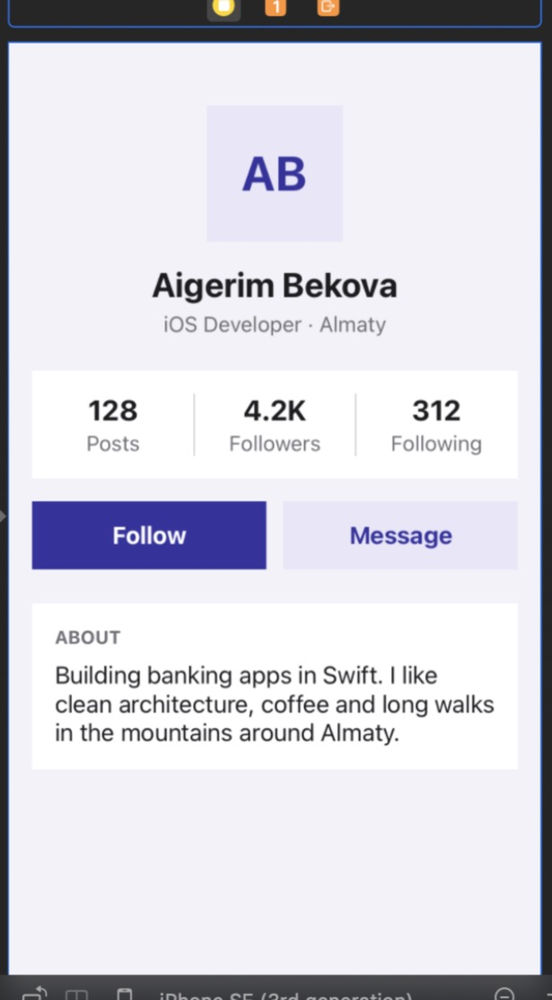
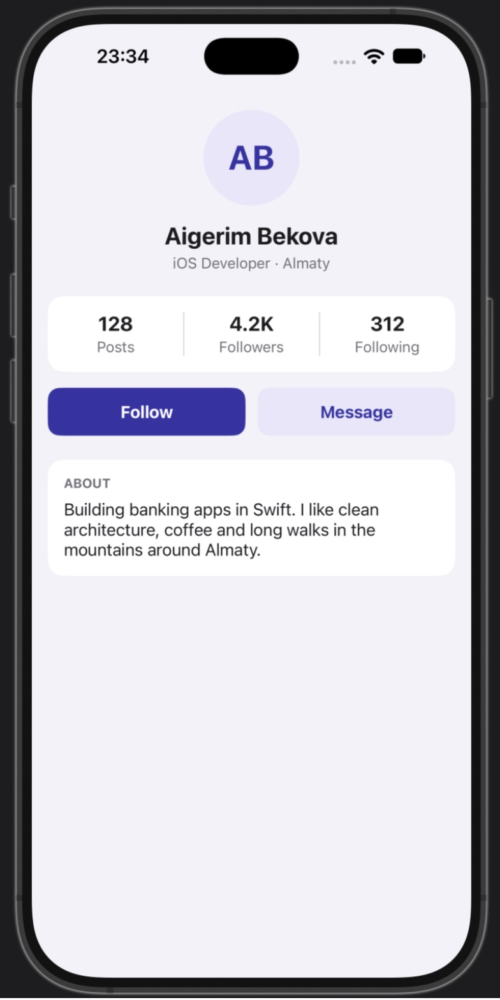
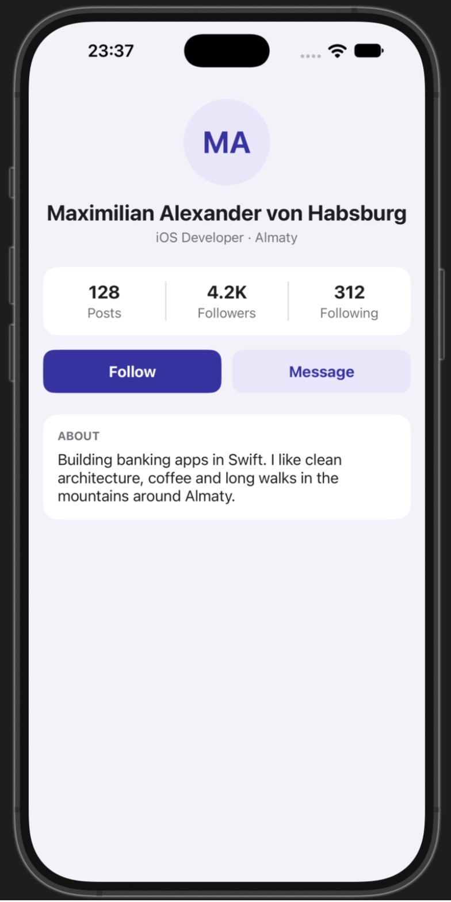

# Lab 7 · Auto Layout — Variant A · Profile

UIKit + Storyboard only. Every view and every constraint is set in Interface Builder; no `UIStackView`.
`ViewController.swift` only fills the labels with data — no frames, no constraints, no anchors.

| Requirement | How it is done |
|---|---|
| Avatar 96 × 96 circle, centered | width = 96, height = 96, centerX to safe area; `layer.cornerRadius = 48` (runtime attribute) |
| Name up to 2 lines, centered | `numberOfLines = 2`, leading/trailing 16 to safe area |
| Stats: 3 equal columns with dividers | 3 column views chained leading → trailing, **Equal Widths**; 1 pt dividers centered on column edges |
| Follow / Message | **Equal Widths**, 12 pt horizontal spacing, height = 48 |
| About text wraps, no line limit | `numberOfLines = 0`, pinned 16 pt inside the card |
| Side margins 16 pt, safe area | every row pinned 16 pt to the safe area; card bottom ≥ 16 pt above safe-area bottom |
| No IB / console warnings | Issue navigator: **No Issues**; no "Unable to simultaneously satisfy constraints" in the console |

Portrait only (the layout is designed for a vertical screen).

Long text test: set `useLongName = true` in `ViewController.swift` → "Maximilian Alexander von Habsburg".

## Screenshots

| iPhone SE (3rd gen) — Interface Builder | iPhone 18 Pro Max — Simulator | Long name test |
|---|---|---|
|  |  |  |

The iOS 27 simulator runtime does not include iPhone SE (3rd gen) or iPhone 16 Pro Max, so SE is shown in Interface Builder's
"View as" preview and the largest available simulator (iPhone 18 Pro Max) is used for the big-screen check.
