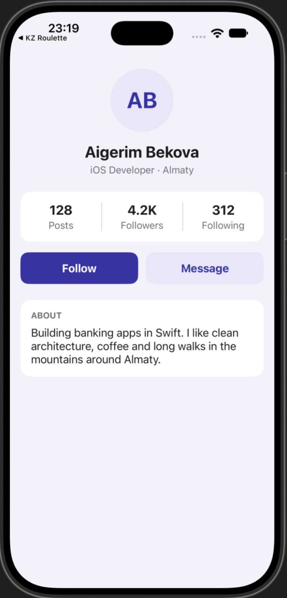

# Lab 7 · Auto Layout — Variant A · Profile

UIKit + Storyboard only. All views and constraints are set in Interface Builder, no UIStackView.
`ViewController.swift` only fills the labels with data.

- Avatar 96 × 96 circle, centered (width/height constraints + centerX)
- Name up to 2 lines, centered
- Stats: 3 columns with **Equal Widths** and 1 pt dividers
- Follow / Message: **Equal Widths**, 12 pt gap, 48 pt tall
- About text wraps with no line limit (`numberOfLines = 0`)
- 16 pt side margins to the safe area

Long text test: set `useLongName = true` in `ViewController.swift`.

## Screenshot

iPhone 18 Pro simulator (iOS 27):

