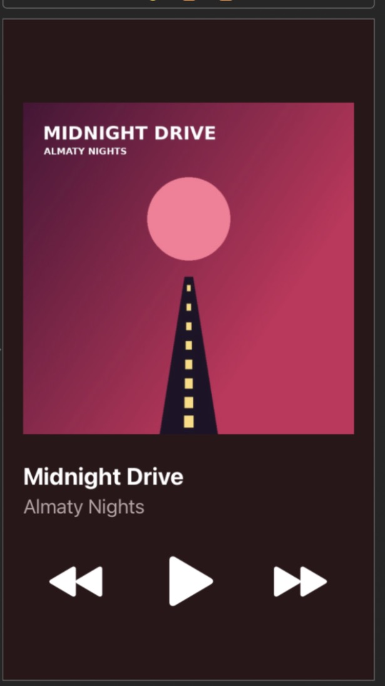
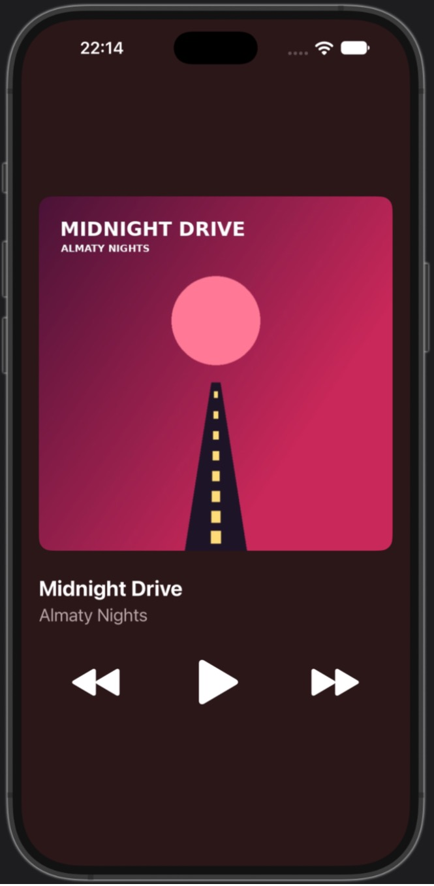

# Lab 8 · Music Player (UIStackView + Auto Layout)

Simple one-screen music player in UIKit.

- Layout is only in `Main.storyboard`: root vertical stack → cover, labels stack, controls stack (3 stack views).
- Root stack: leading/trailing 20 pt to Safe Area, centered vertically. Cover has a 1:1 aspect ratio constraint.
- `Track` struct and `TrackLibrary` with 10 tracks (`Track.swift`).
- Playback with `AVAudioPlayer`, files are loaded from `Bundle.main`.
- Play/Pause changes the icon, Next/Previous wrap around the list, next track starts automatically when one ends.

Music: 10 instrumental beats made for this project (royalty-free), files in `MusicPlayer/Music`, ~500 KB each.

## Screenshots

| iPhone SE (3rd gen) | iPhone 16 Pro Max |
|---|---|
|  |  |

## Demo

Screen recording: `screenshots/demo.mov`
